<div align="center">

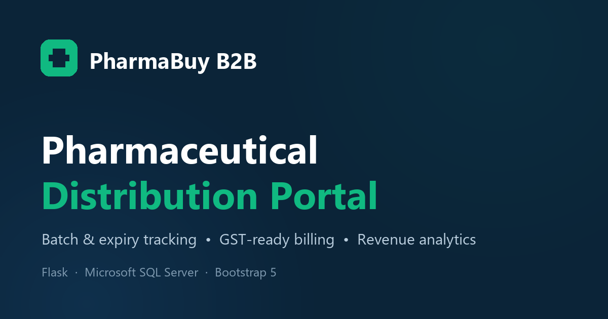

# PharmaBuy B2B

**A pharmaceutical distribution portal for pharmacies and clinics — batch-aware stock, GST-ready checkout, revenue analytics and a live database explorer.**

[](https://www.python.org/)
[](https://flask.palletsprojects.com/)
[](https://www.microsoft.com/sql-server)
[](https://getbootstrap.com/)
[](LICENSE)

[Features](#features) · [Screenshots](#screenshots) · [Tech stack](#tech-stack) · [Database](#database-design) · [Setup](#getting-started) · [Routes](#route-reference) · [Docs](docs/SETUP.md)

</div>

---

## Overview

PharmaBuy B2B is a complete, working pharmacy distribution web application built for a
Database Management Systems course project. It pairs a normalised Microsoft SQL Server
schema (16 tables, 14 foreign keys, constraints and indexes) with a Flask front end, so the
database work is visible in the UI: every screen is driven by real SQL, not mock data.

A pharmacy can browse medicines by therapeutic category, compare live batch availability and
expiry dates, add items to a session cart, check out with GST calculated per medicine, and
revisit the invoice later. Staff get an operations dashboard, low-stock alerts, revenue
analytics with charts, and a read-only explorer for every table in the database.

> **Demo data only.** The shipped dataset is synthetic. Prices, stock, customers and orders
> are fictional and must not be used for any clinical or commercial purpose.

---

## Features

### Customer portal
- **Self-registration** — creates a `User_Login` row and a linked `Customer` profile.
- **Searchable catalog** — 290 medicines across 10 categories, filter by category or brand.
- **Batch-level detail** — every available batch with expiry date, rack location and price;
  expired and zero-stock batches are excluded automatically.
- **Session cart** — add, change quantity or remove items without touching the database.
- **GST-aware totals** — per-medicine GST percentage, live subtotal / tax / grand total.
- **Checkout** — creates `Sales`, `Sales_Items`, `Payment` and `Stock_Log` rows in one
  transaction, decrements stock, and optionally pushes an invoice payload to an n8n webhook.
- **Order history** — customers only ever see their own orders; staff see everything.

### Staff and administration
- **Dashboard** — counts, order volume, low-stock batches and new stock arrivals.
- **Admin panel** — revenue, customers, sales, low-stock table and quick actions.
- **Revenue analytics** — filter by all time, month or year; KPIs for revenue, order value and
  unique customers; breakdowns by payment mode and category; top medicines and top customers;
  trend chart rendered with Chart.js.
- **Database explorer** — lists all 16 tables and previews their rows read-only, with a
  server-side whitelist so arbitrary table names cannot be queried.
- **Role-based access** — `ADMIN`, `MANAGER`, `PHARMACIST` and `CASHIER` roles via decorators.

### Engineering details
- Server-rendered Jinja templates, no client-side framework to build.
- Configuration comes from environment variables (`.env`), never from committed code.
- Shared cart-pricing helper so the cart page and checkout page can never disagree.
- Custom 404 page, `robots.txt`, `sitemap.xml`, Open Graph / Twitter metadata, SVG favicon
  and a social preview image.
- Accessible markup: skip link, labelled inputs, ARIA attributes on interactive elements.
- Print stylesheet included so order confirmations print cleanly.

---

## Screenshots

| Login | Dashboard |
| --- | --- |
| 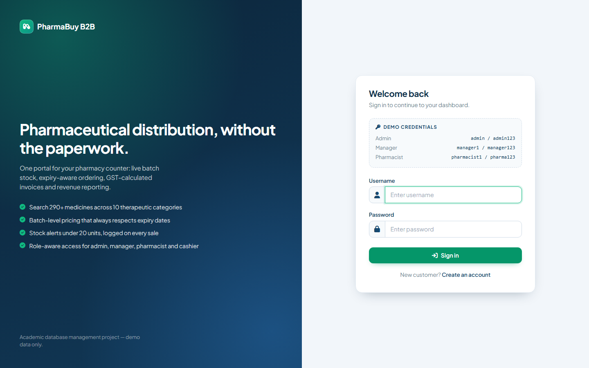 | 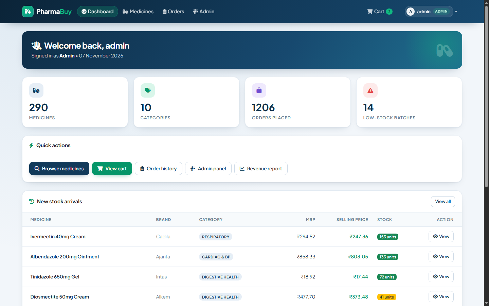 |

| Medicine catalog | Medicine detail (batches) |
| --- | --- |
| 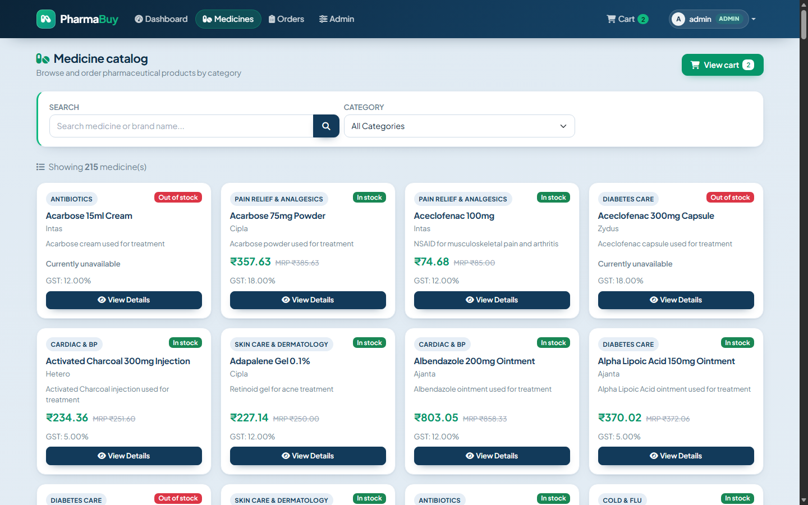 | 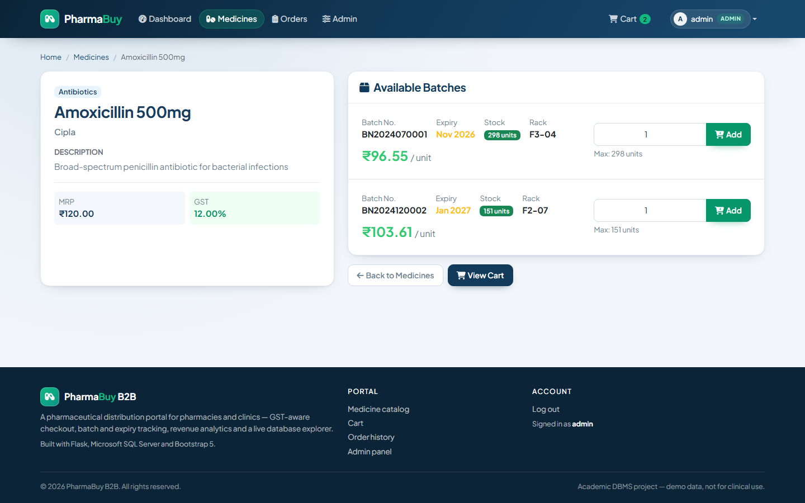 |

| Cart | Checkout |
| --- | --- |
| 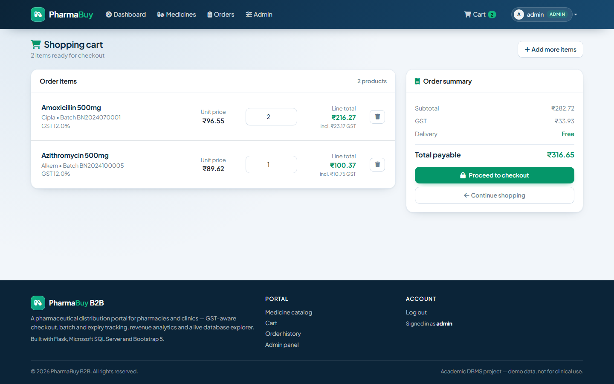 | 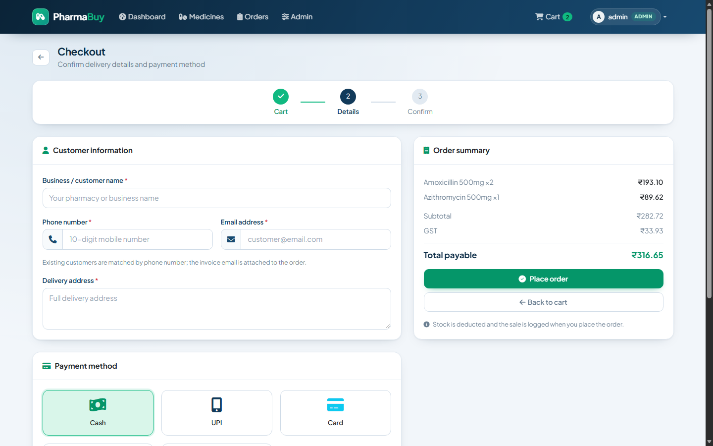 |

| Order history | Admin panel |
| --- | --- |
| 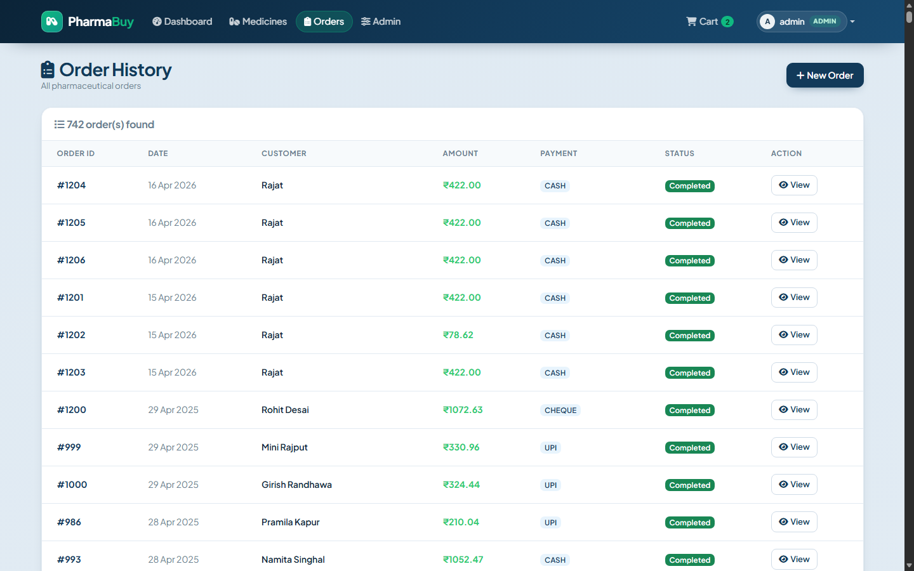 | 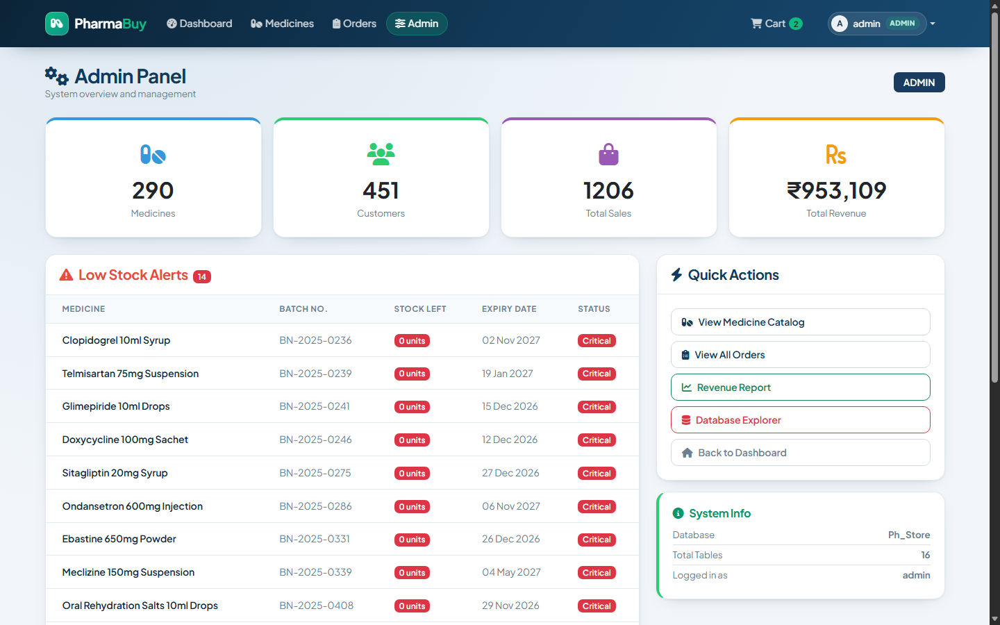 |

| Revenue analytics | Database explorer |
| --- | --- |
| 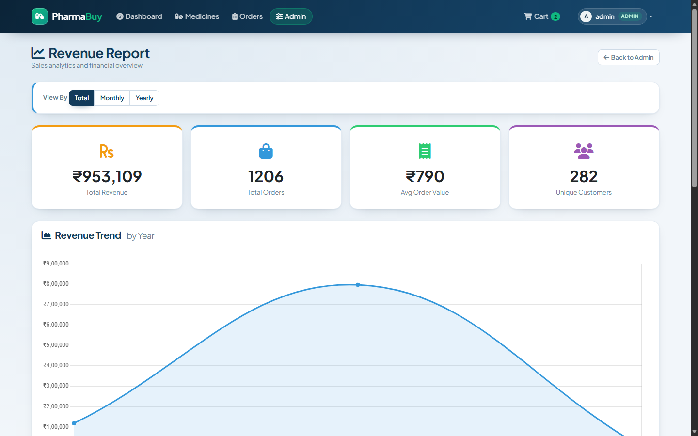 | 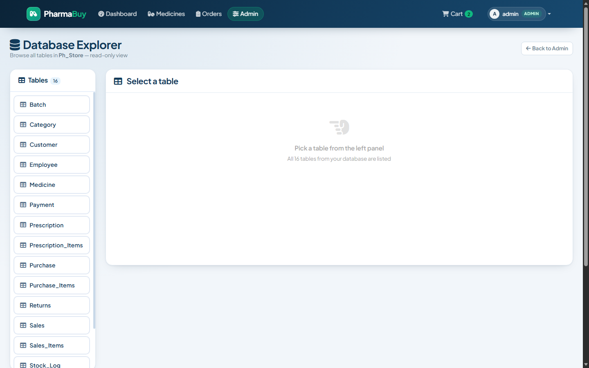 |

---

## Tech stack

| Layer | Choice |
| --- | --- |
| Language | Python 3.10+ |
| Web framework | Flask 3 (Jinja2 templates, session cookies, blueprints-free single module) |
| Database | Microsoft SQL Server 2019+ (`Ph_Store`) via `pyodbc` and ODBC Driver 17 |
| Front end | Bootstrap 5.3, Font Awesome 6, Bootstrap Icons-style CSS layer, Chart.js 4 |
| Configuration | `python-dotenv` + environment variables |
| Tooling | `sqlcmd` / SSMS for schema + seed scripts, `waitress` or `gunicorn` for hosting |

---

## Database design

The schema is intentionally normalised so the project exercises real relational modelling:
primary keys, foreign keys, `CHECK` constraints, unique keys, computed stock movement logs and
indexes on the columns used by the reporting queries.

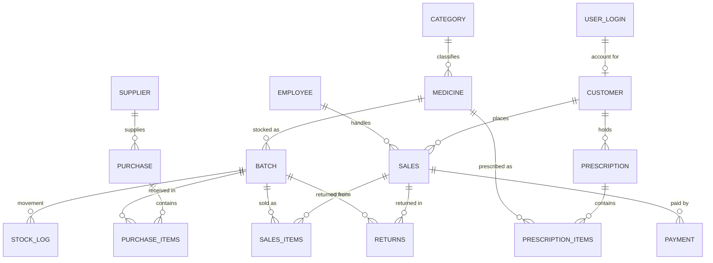

| Table | Purpose |
| --- | --- |
| `Category` | Therapeutic category of a medicine (10 rows seeded). |
| `Medicine` | Catalog item: brand, category, description, MRP, GST %. |
| `Batch` | Physical stock lot: batch number, manufacture/expiry dates, cost, selling price, quantity, rack. |
| `Stock_Log` | Append-only inventory movements (`PURCHASE`, `SALE`, `RETURN`, ...). |
| `Supplier` | Wholesaler that supplies batches. |
| `Purchase` / `Purchase_Items` | Purchase orders and the batches they delivered. |
| `Customer` | Buyer profile, optionally linked to a login via `username`. |
| `Employee` | Staff record with role and salary. |
| `Sales` / `Sales_Items` | Orders and the batch/quantity/price lines they contain. |
| `Payment` | One payment row per sale (`CASH`, `CARD`, `UPI`, `NET_BANKING`, `CHEQUE`). |
| `Returns` | Returned quantity and reason per batch. |
| `Prescription` / `Prescription_Items` | Doctor prescriptions and dosage lines. |
| `User_Login` | Credentials and role (`ADMIN`, `MANAGER`, `PHARMACIST`, `CASHIER`, `CUSTOMER`). |

SQL lives in [`database/`](database):

| File | What it does |
| --- | --- |
| `schema.sql` | Creates the `Ph_Store` database, all 16 tables, constraints and indexes, plus reference rows. |
| `sample_data.sql` | Loads the demo dataset used by the screenshots (clears tables first). |
| `seed_admin_logins.sql` | Restores the demo admin / manager / pharmacist / cashier logins. |
| `queries.sql` | A study set of retrieval queries (joins, aggregates, window functions) for the report. |
| `migrations/001_customer_account_columns.sql` | Idempotent patch that adds `Customer.email` / `Customer.username` to older databases. |

---

## Project structure

```
Pharma-Buy/
├── app.py                     # Flask application: routes, SQL, helpers
├── requirements.txt           # Python dependencies
├── start_server.bat           # One-click Windows launcher
├── .env.example               # Documented environment variables
├── .gitignore
├── README.md
├── LICENSE
│
├── database/
│   ├── schema.sql             # DDL: 16 tables + constraints + indexes
│   ├── sample_data.sql        # Demo dataset
│   ├── seed_admin_logins.sql  # Demo staff accounts
│   ├── queries.sql            # Retrieval query study set
│   └── migrations/
│       └── 001_customer_account_columns.sql
│
├── docs/
│   ├── SETUP.md               # Detailed installation & troubleshooting
│   └── screenshots/           # Images used by this README
│
├── static/
│   ├── css/style.css          # Design system layered on Bootstrap
│   ├── js/main.js             # Flash messages, tooltips, payment picker
│   └── img/                   # favicon.svg, social-preview.png
│
└── templates/
    ├── base.html              # Layout, SEO meta, navbar, footer
    ├── login.html
    ├── register.html
    ├── dashboard.html
    ├── medicines.html
    ├── medicine_detail.html
    ├── cart.html
    ├── checkout.html
    ├── order_confirmation.html
    ├── orders.html
    ├── admin.html
    ├── revenue.html
    ├── db_explorer.html
    └── 404.html
```

---

## Getting started

### Prerequisites

| Requirement | Notes |
| --- | --- |
| Python 3.10+ | `python --version` |
| Microsoft SQL Server 2019+ | Express edition works; default instance name `SQLEXPRESS` |
| ODBC Driver 17 for SQL Server | [Download](https://learn.microsoft.com/sql/connect/odbc/download-odbc-driver-for-sql-server) |
| SQL Server Management Studio (optional) | Handy for running the scripts |

### 1. Create the database

```bash
cd Pharma-Buy

# schema + indexes + reference data
sqlcmd -S localhost\SQLEXPRESS -E -i database/schema.sql

# demo dataset (clears the tables first, then inserts ~ 4,000 rows)
sqlcmd -S localhost\SQLEXPRESS -E -i database/sample_data.sql

# demo staff logins
sqlcmd -S localhost\SQLEXPRESS -E -i database/seed_admin_logins.sql
```

No `sqlcmd`? Run the same files from SSMS (`File → Open → File`, then *Execute*).
Already have a database created from an older schema? Also run
`database/migrations/001_customer_account_columns.sql`.

### 2. Install the application

```bash
python -m venv .venv
.venv\Scripts\activate          # Windows
# source .venv/bin/activate     # macOS / Linux

pip install -r requirements.txt
```

### 3. Configure the environment

```bash
copy .env.example .env          # Windows
# cp .env.example .env          # macOS / Linux
```

Edit `.env` and set at minimum `SECRET_KEY` and `DB_SERVER`:

```dotenv
SECRET_KEY=<output of: python -c "import secrets; print(secrets.token_hex(32))">
DB_SERVER=localhost\SQLEXPRESS
DB_NAME=Ph_Store
```

### 4. Run it

```bash
python app.py
```

Open <http://127.0.0.1:5000> — or double-click `start_server.bat`, which installs
dependencies and creates `.env` for you on first run.

#### Demo credentials

| Role | Username | Password | Lands on |
| --- | --- | --- | --- |
| Admin | `admin` | `admin123` | Dashboard + admin panel + DB explorer |
| Manager | `manager1` | `manager123` | Dashboard + admin panel |
| Pharmacist | `pharmacist1` | `pharma123` | Dashboard + catalog |
| Cashier | `cashier1` | `cash123` | Dashboard + catalog |

Customers create their own account from the **Register** page.

---

## Environment variables

| Variable | Default | Purpose |
| --- | --- | --- |
| `SECRET_KEY` | random per boot | Flask session signing key. Set it to keep sessions across restarts. |
| `DB_SERVER` | `localhost\SQLEXPRESS` | SQL Server instance. |
| `DB_NAME` | `Ph_Store` | Database name. |
| `DB_DRIVER` | `ODBC Driver 17 for SQL Server` | ODBC driver name. |
| `DB_TRUSTED_CONNECTION` | `yes` | `yes` = Windows auth, `no` = SQL Server auth. |
| `DB_USERNAME` / `DB_PASSWORD` | empty | Used when trusted connection is disabled. |
| `N8N_WEBHOOK_URL` | `http://localhost:5678/webhook/pharmacy-invoice` | Optional invoice webhook; failures are ignored. |
| `FLASK_DEBUG` | `0` | Set to `1` for the reloader and debugger. Never enable it on a shared host. |
| `HOST` / `PORT` | `127.0.0.1` / `5000` | Development server bind address. |

---

## Route reference

| Method | Route | Access | Description |
| --- | --- | --- | --- |
| GET | `/` | public | Redirects to the dashboard or the login page. |
| GET/POST | `/login` | public | Sign in with a `User_Login` row. |
| GET/POST | `/register` | public | Create a customer account. |
| GET | `/logout` | any | Clears the session. |
| GET | `/dashboard` | staff | Counters, low stock, new stock arrivals. |
| GET | `/medicines` | logged in | Catalog with `?search=` and `?category=` filters. |
| GET | `/medicine/<id>` | logged in | Batches, prices, expiry and add-to-cart. |
| GET | `/cart` | logged in | Priced cart with GST totals. |
| POST | `/add_to_cart` | logged in | Add a batch to the session cart. |
| POST | `/update_cart` | logged in | Change a line quantity. |
| GET | `/remove_from_cart/<batch>` | logged in | Remove a line. |
| GET/POST | `/checkout` | logged in | Delivery details, payment method, order placement. |
| GET | `/order_confirmation/<id>` | logged in | Invoice view. |
| GET | `/orders` | logged in | Own orders (customers) or all orders (staff). |
| GET | `/admin` | admin / manager | Operations panel. |
| GET | `/admin/revenue` | admin / manager | Revenue analytics with `?mode=total|monthly|yearly`. |
| GET | `/admin/db-explorer` | admin / manager | Table list. |
| GET | `/admin/db-explorer/table?table=` | admin / manager | JSON rows for a whitelisted table. |
| GET | `/api/search_medicines?q=` | logged in | JSON search used by the catalog. |
| GET | `/robots.txt`, `/sitemap.xml` | public | Crawler hints for the public pages. |

---

## How an order is processed

1. `POST /checkout` reads the customer fields and the session cart.
2. The customer is matched by phone number, or inserted if new.
3. For each cart line the price, stock and GST are re-read from `Batch` — a client cannot
   change the price, and a line with insufficient stock aborts the whole order.
4. One `Sales` row is inserted, then one `Sales_Items` row per line.
5. `Batch.stock_qty` is decremented and a `Stock_Log` row (`change_type = 'SALE'`) is written.
6. A `Payment` row records the chosen payment mode and amount.
7. The session cart is cleared, and an invoice payload is POSTed to the optional n8n webhook
   (any failure there is swallowed so the order still succeeds).

---

## Security notes and known limitations

This is a **teaching project**, and the schema intentionally mirrors the assignment brief.
Before using it for anything real:

- **Passwords are stored in plain text** and compared directly, exactly as the original schema
  requires. Replace with `werkzeug.security.generate_password_hash` / `check_password_hash`
  and a migration for existing rows.
- **No CSRF protection.** Add `Flask-WTF` and `CSRFProtect`, or per-form tokens, before
  exposing the app beyond localhost.
- **The demo accounts ship with known passwords.** Delete or rotate them in any real deployment.
- Parameterised SQL is used everywhere user input reaches a query; the DB explorer additionally
  whitelists table names against `INFORMATION_SCHEMA`. Keep both habits if you extend it.
- Serve it behind a production WSGI server (`waitress-serve --port=8000 app:app` on Windows,
  `gunicorn app:app` on Linux) and HTTPS — the Flask dev server is for local use only.
- Checkout is not idempotent: a double submit can create two orders.

---

## Roadmap ideas

- Password hashing + CSRF tokens and a proper user-management screen.
- Lot-level stock transfers and a purchase-order entry form.
- Prescription upload and validation during checkout.
- Pagination for the catalog and order list.
- Automated tests (`pytest` + a disposable SQL Server database) and CI.

---

## Contributing

1. Fork the repository and create a feature branch: `git checkout -b feature/my-change`.
2. Keep SQL parameterised and configuration in `.env` (never commit secrets).
3. Update `README.md` / `docs/SETUP.md` when behaviour changes.
4. Open a pull request describing the change and how you verified it.

---

## License

Released under the [MIT License](LICENSE).

## Acknowledgements

- Schema and demo dataset produced for an academic DBMS project.
- UI built on [Bootstrap](https://getbootstrap.com/), [Font Awesome](https://fontawesome.com/)
  and [Chart.js](https://www.chartjs.org/); typography set in
  [Plus Jakarta Sans](https://fonts.google.com/specimen/Plus+Jakarta+Sans).
